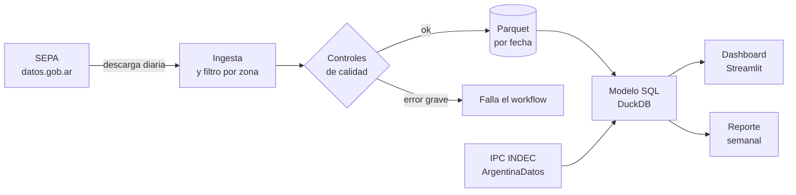

# Monitor de precios de supermercados

> **Proyecto en construcción.** Por ahora estoy en la etapa de reconocimiento de la fuente de datos.

Este proyecto descarga todos los días los precios que los supermercados de Argentina informan a la base **SEPA** (Precios Claros, [datos.gob.ar](https://datos.gob.ar)). Con esos datos arma su propio historial y controla su calidad. Después los modela en DuckDB y publica un dashboard y un reporte semanal que se actualizan solos.

El portal publica los precios del día pero no guarda el historial. Por eso este monitor tiene que descargarlos todos los días: un día que no se descarga es un día de datos que se pierde.

## Preguntas que busca responder

1. ¿Cuánto cambia el precio del mismo producto según la cadena y la zona?
2. ¿En qué cadena sale más barata una canasta de productos básicos y cuánto se ahorra frente a la más cara?
3. ¿Cuánto más se paga por la marca líder frente a la segunda marca o la marca propia?
4. ¿Cómo cambian los precios semana a semana y cómo se comparan con el IPC del INDEC?
5. ¿Las promociones son reales o el precio "de oferta" es el precio de siempre?

## Cómo funciona



## Stack

| Para qué | Herramienta |
|---|---|
| Descarga y orquestación | Python |
| Transformaciones y métricas | DuckDB y SQL |
| Almacenamiento | Parquet particionado por fecha |
| Automatización | Programador de tareas de Windows (GitHub Actions corre los tests) |
| Dashboard | Streamlit |
| Inflación oficial | API de ArgentinaDatos (IPC del INDEC) |

## Criterios metodológicos

- Para los precios uso **medianas** y no promedios, para que un valor extremo no distorsione el resultado.
- Los rankings solo incluyen casos con un **mínimo de observaciones**.
- Al comparar cadenas **controlo por zona**, para no confundir una cadena cara con una cadena que tiene sucursales en barrios caros.
- La canasta tiene una **composición fija**, así que el índice propio mide el cambio de precios y no un cambio en los productos.
- Cada decisión queda documentada en `docs/decisiones.md`, con las alternativas que descarté.

## Estado

- [x] Etapa 0: reconocimiento de la base SEPA ([documentación de la fuente](docs/fuente_sepa.md))
- [x] Etapa 1: pipeline de descarga
- [x] Etapa 2: controles de calidad
- [ ] Etapa 3: automatización de la descarga diaria
- [x] Etapa 4: modelo de datos en SQL
- [ ] Etapa 5: análisis
- [ ] Etapa 6: dashboard
- [ ] Etapa 7: reporte semanal automático

## Limitaciones conocidas

- Son los precios que **informan las cadenas**, no precios de tickets reales.
- Solo están las cadenas obligadas a informar a SEPA, que son las más grandes.
- El historial empieza el día en que arrancó la descarga automática.
- Si la fuente cambia de formato, el pipeline puede romperse. Los controles de calidad están para detectarlo.

## Cómo correrlo en local

Requiere Python 3.11 o más nuevo.

```bash
python -m venv .venv
.venv\Scripts\activate          # en Linux o macOS: source .venv/bin/activate
pip install -r requirements.txt

python -m src.ingesta           # descarga y guarda los días disponibles que falten (hasta 7)
```

Otras opciones:

| Comando | Qué hace |
|---|---|
| `python -m src.ingesta --dia lunes` | Procesa solo el paquete de ese día de la semana. |
| `python -m src.ingesta --archivo sepa_lunes.zip` | Procesa un zip ya descargado. |
| `python -m src.ingesta --forzar` | Reprocesa aunque la fecha ya esté guardada. |
| `python -m src.ingesta --aceptar-errores` | Guarda el día aunque los controles de calidad den error grave. |
| `python -m pytest` | Corre los tests. |

Cada día procesado queda en `data/<tabla>/fecha=AAAA-MM-DD/<tabla>.parquet` (precios, sucursales, comercios y productos),
y el resumen de cada corrida en `data/ingesta/log_ingesta.csv`.

### Controles de calidad

Antes de guardar cada día se corren 14 controles (`src/calidad.py` y `sql/calidad/`). Su resultado queda en
`data/calidad/log_calidad.csv`, con la columna `resultado` en `ok`, `advertencia` o `error`.

- **Error grave:** el día no se guarda y el comando termina con código de salida 1 (así la tarea diaria sabe que falló y avisa).
- **Advertencia:** el día se guarda y el aviso queda registrado.

| Control | Qué detecta | Advertencia | Error |
|---|---|---|---|
| `columnas_faltantes` | El formato de los CSV cambió | | cualquier columna |
| `fecha_paquete` | Archivo viejo o fecha distinta a la del portal | | sí |
| `portal_actualizado` | El portal no publicó datos de hoy ni de ayer | | más de 1 día |
| `comercios_descartados` | Zip vacío o con datos viejos | cualquiera | |
| `sin_precios` | El día quedó sin ningún precio | | sí |
| `precios_invalidos` | Precios vacíos, cero o negativos | cualquiera | más del 1% de las filas |
| `duplicados` | Misma sucursal y producto repetidos | cualquiera | más del 1% |
| `precios_absurdos` | Más de 100 veces (o menos de 1/100) de la mediana del producto | cualquiera | más del 1% |
| `precios_sin_sucursal` | Precios de sucursales que no figuran en `sucursales.csv` | cualquiera | más del 5% |
| `sucursales_sin_precios` | Sucursales de la zona sin ningún precio | cualquiera | más del 20% |
| `banderas_sin_comercio` | Precios de una bandera que no figura en `comercio.csv` | cualquiera | |
| `variacion_filas` | Caída de filas frente al último día guardado | más del 10% | más del 30% |
| `dias_sin_datos` | Días sin datos guardados entre el último día y este (la ejecución diaria no corrió) | cualquiera | |
| `banderas_ausentes` | Cadenas que informaron el día anterior y hoy no | cualquiera | |
| `caida_sucursales_bandera` | Cadenas que informan menos de la mitad de sus sucursales | cualquiera | |

Los precios inválidos, duplicados y absurdos se descartan antes de guardar. El criterio completo está en `docs/decisiones.md` (decisiones 8 y 9).

### Automatización

La descarga diaria corre en tu PC con el **Programador de tareas de Windows**, todos los días a las 15:00. No corre en GitHub Actions porque
el portal bloquea las IP de GitHub (HTTP 403, ver `docs/decisiones.md`, decisión 10). Actions solo corre los tests en cada Pull Request.

Para dejarla funcionando (una sola vez):

1. Instalar la [CLI de GitHub](https://cli.github.com) y correr `gh auth login`.
2. Registrar la tarea, desde PowerShell en la carpeta del proyecto:

```powershell
.\scripts\registrar_tarea.ps1               # todos los días a las 15:00
.\scripts\registrar_tarea.ps1 -Hora "16:30" # otra hora
```

Cada día la tarea baja el paquete, lo controla, lo guarda, sube los Parquet a los Releases del repo y actualiza el modelo (`data/modelo.duckdb`). Si algo falla, muestra una ventana de aviso.

| Qué | Dónde |
|---|---|
| Parquet diarios (~17 MB por día) | Un Release por mes: `datos-2026-11`, `datos-2026-12`... |
| Logs de ingesta y de calidad | Release `datos-logs` (se reemplazan en cada corrida) |
| Resultado de la última ejecución | `data/ingesta/ultima_ejecucion.log` (en tu PC) |

La PC no tiene que estar prendida siempre: el portal guarda los últimos 7 días, así que podés apagarla hasta 6 días seguidos sin perder datos.
Si la tarea se perdió la hora, corre apenas la prendés.

| Comando | Qué hace |
|---|---|
| `python -m src.diaria` | Lo que hace la tarea: bajar, ingerir, subir y actualizar el modelo. |
| `Start-ScheduledTask -TaskName "Monitor precios supermercados"` | Lanza la tarea ahora. |
| `Unregister-ScheduledTask -TaskName "Monitor precios supermercados" -Confirm:$false` | La saca del Programador. |
| `python -m src.almacen subir` / `bajar --dias 10` | Sube o baja los Parquet y los logs a mano. |
| `python -m src.ingesta --verificar-acceso` | Prueba que se pueda llegar al portal. |

Los tests de GitHub instalan solo `requirements-pipeline.txt` (DuckDB y pytest). El resto de `requirements.txt` es para los notebooks.

### Modelo de datos

```
python -m src.modelo             # carga los días nuevos y recalcula las métricas (2 segundos si no hay nada nuevo)
python -m src.modelo --rehacer   # lo arma de cero con todos los días guardados (~30 segundos con 7 días)
```

Genera `data/modelo.duckdb`. Todas las transformaciones están en SQL, en la carpeta `sql/`:

| Capa | Tablas |
|---|---|
| `01_staging` | Vistas temporales sobre los Parquet y los archivos de `config/` |
| `02_dimensiones` | `dim_fecha`, `dim_cadena`, `dim_sucursal`, `dim_producto`, `dim_canasta`, `dim_par_marca`, `parametros` |
| `03_hechos` | `fct_precios` (sucursal, producto y día), `fct_precio_representativo` (mediana por cadena, zona y día), `fct_cobertura_dia` |
| `04_metricas` | `m_canasta_dia`, `m_ranking_canasta_dia`, `m_indice_cadena_dia`, `m_indice_general_dia`, `m_dispersion_producto_dia`, `m_prima_marca_dia` |

Los hechos son incrementales: cada día se carga una sola vez, y se vuelve a cargar si su Parquet se reprocesó.

Lo que se puede cambiar sin tocar el código está en `config/`:

| Archivo | Qué define |
|---|---|
| `cadenas.csv` | Qué es cada cadena y su rubro (supermercado, farmacia, tienda de conveniencia) |
| `canasta.csv` | Los 30 productos de la canasta, por código EAN |
| `marcas.csv` | Pares de producto líder y alternativo para la prima de marca |
| `parametros.csv` | Mínimo de sucursales para comparar cadenas, día base del índice, días de arrastre de precios y otros |

Ejemplo, el ranking de la canasta del último día:

```sql
select posicion, cadena, costo_canasta, sobre_la_mas_barata_pct
from m_ranking_canasta_dia
where zona = 'TODAS' and fecha = (select max(fecha) from m_ranking_canasta_dia)
order by posicion;
```

Las decisiones de diseño (qué es una cadena, cómo se eligió la canasta, cómo se calcula el índice) están en `docs/decisiones.md`, decisiones 11 a 15.
