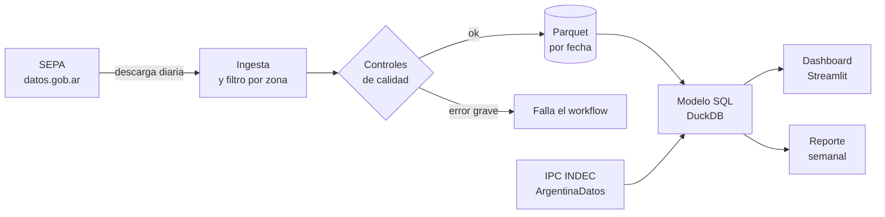

# Monitor de precios de supermercados

> **Proyecto en construcción.** Por ahora estoy en la etapa de reconocimiento de la fuente de datos.

Este proyecto descarga todos los días los precios que los supermercados de Argentina informan a la base **SEPA** (Precios Claros, [datos.gob.ar](https://datos.gob.ar)). Con esos datos arma su propio historial y controla su calidad. Después los modela en DuckDB y publica un dashboard y un reporte semanal que se actualizan solos.

El portal publica los precios del día pero no guarda el historial. Por eso este monitor tiene que descargarlos todos los días: un día que no se descarga es un día de datos que se pierde.

## Preguntas que busca responder

1. ¿Cuánto cambia el precio del mismo producto según la cadena y la zona?
2. ¿En qué cadena sale más barata una canasta de productos básicos y cuánto se ahorra frente a la más cara?
3. ¿Cuánto más se paga por la marca líder frente a la segunda marca o la marca propia?
4. ¿Cómo cambian los precios semana a semana y cómo se comparan con el IPC del INDEC?
5. ¿Las promociones son reales o el precio "de oferta" es el precio de siempre?

## Cómo funciona

## Stack

| Para qué | Herramienta |
|---|---|
| Descarga y orquestación | Python |
| Transformaciones y métricas | DuckDB y SQL |
| Almacenamiento | Parquet particionado por fecha |
| Automatización | GitHub Actions |
| Dashboard | Streamlit |
| Inflación oficial | API de ArgentinaDatos (IPC del INDEC) |

## Criterios metodológicos

- Para los precios uso **medianas** y no promedios, para que un valor extremo no distorsione el resultado.
- Los rankings solo incluyen casos con un **mínimo de observaciones**.
- Al comparar cadenas **controlo por zona**, para no confundir una cadena cara con una cadena que tiene sucursales en barrios caros.
- La canasta tiene una **composición fija**, así que el índice propio mide el cambio de precios y no un cambio en los productos.
- Cada decisión queda documentada en `docs/decisiones.md`, con las alternativas que descarté.

## Estado

- [ ] Etapa 0: reconocimiento de la base SEPA
- [ ] Etapa 1: pipeline de descarga
- [ ] Etapa 2: controles de calidad
- [ ] Etapa 3: automatización con GitHub Actions
- [ ] Etapa 4: modelo de datos en SQL
- [ ] Etapa 5: análisis
- [ ] Etapa 6: dashboard
- [ ] Etapa 7: reporte semanal automático

## Limitaciones conocidas

- Son los precios que **informan las cadenas**, no precios de tickets reales.
- Solo están las cadenas obligadas a informar a SEPA, que son las más grandes.
- El historial empieza el día en que arrancó la descarga automática.
- Si la fuente cambia de formato, el pipeline puede romperse. Los controles de calidad están para detectarlo.

## Cómo correrlo en local

*Pendiente: se completa cuando esté lista la etapa 1.*
