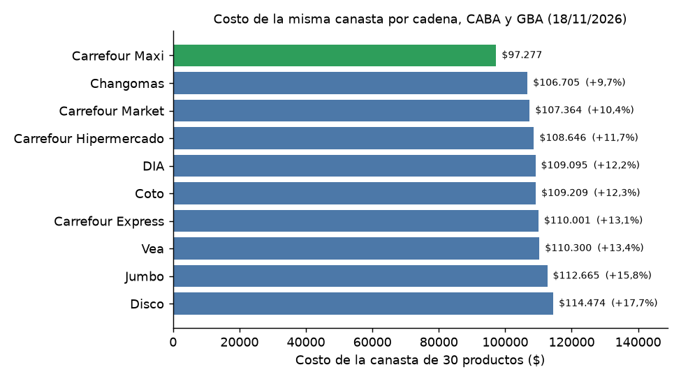
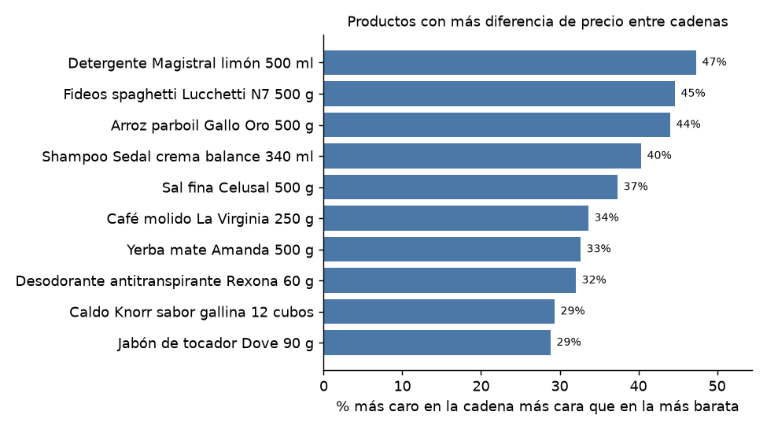
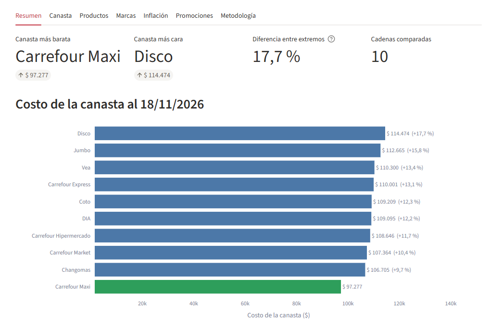
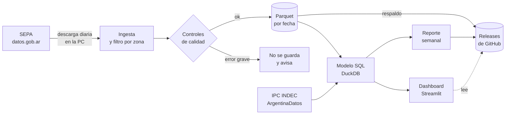

# Monitor de precios de supermercados


Todos los días, este proyecto descarga los precios que los supermercados de Argentina informan a la base **SEPA** (Precios Claros, [datos.gob.ar](https://datos.gob.ar)) en CABA y GBA, y arma con ellos su propio historial. Controla la calidad de cada día, los modela en SQL con DuckDB y los publica en un dashboard y en un reporte semanal que se actualizan solos.

El portal publica los precios del día pero **no guarda el historial**. Por eso hay que descargarlos todos los días: un día que no se baja es un día de datos que se pierde.

## Lo que encontré

> Con **7 días de datos** (12 al 18 de noviembre de 2026). Las comparaciones entre cadenas ya se pueden leer; la evolución en el tiempo todavía no. Los números se actualizan en el [dashboard](https://precios-super.streamlit.app) y en el reporte semanal.

**1. Elegir la cadena importa más que dónde se vive.** La misma cadena cobra lo mismo en CABA que en GBA (diferencia de 0% a −0,3%). Las diferencias de precio están entre cadenas, no entre zonas.

**2. La misma canasta de 30 productos básicos cuesta un 17,7% más en Disco que en Carrefour Maxi.** Elegir la más barata ahorra un 15% sobre la más cara. Carrefour Maxi se despega: la segunda, Changomas, ya está un 9,7% arriba, y del segundo al décimo lugar hay 8 puntos.



**3. El mismo producto llega a costar un 47% más según la cadena.** El detergente, los fideos, el arroz y el shampoo cuestan más de un 40% más en la cadena más cara. Los productos más estandarizados (gaseosa, agua, dulce de leche, manteca) casi no varían: menos de 6%.



**4. La marca líder cuesta entre un 7% menos y un 37% más que la alternativa, según el producto.** Dentro de la misma cadena, el detergente líder cuesta un 37% más que su alternativa, el jabón líquido para ropa un 18% y la crema dental un 12%. En el aceite el "líder" resultó más barato (−7%).

**5. Las promociones son frecuentes en pocas cadenas y fuertes cuando existen.** Informan DIA, Carrefour y Coto, con descuentos medianos de 20% a 25%. Entre el 16% y el 58% de los productos en promoción la sostienen todos los días de la semana, lo que se parece más a un precio de lista alto que a una oferta. Las demás cadenas no informan promociones.

**Lo que todavía no se puede decir:** si los precios suben más o menos que la inflación (el IPC es mensual y hay una semana de datos: el índice propio quedó en 100) y si las ofertas son "el precio de siempre" (hace falta ver semanas). Esas dos preguntas se responden cuando haya 4 o 5 semanas.

## Dashboard y reporte semanal

- **[Dashboard en Streamlit](https://precios-super.streamlit.app):** ranking de la canasta, evolución, productos, marcas, inflación y promociones, con filtro por zona. Código en [`app/`](app/app.py). Si la app está dormida por falta de visitas, tocá "Yes, get this app back up" y esperá unos segundos.
- **Reporte semanal:** un Markdown por semana (lunes a domingo) con qué cadena fue la más barata, cómo cambió el ranking y el índice, qué productos subieron y bajaron, las promociones y la calidad de los datos. Se publican en el Release `reportes-semanales`.
- **Análisis:** [notebook](notebooks/01_analisis.ipynb) que responde las cinco preguntas con consultas SQL de [`sql/05_analisis/`](sql/05_analisis/).



## Preguntas que responde

1. ¿Cuánto cambia el precio del mismo producto según la cadena y la zona?
2. ¿En qué cadena sale más barata una canasta de productos básicos y cuánto se ahorra frente a la más cara?
3. ¿Cuánto más se paga por la marca líder frente a la segunda marca?
4. ¿Cómo cambian los precios semana a semana y cómo se comparan con el IPC del INDEC?
5. ¿Las promociones son reales o el precio "de oferta" es el precio de siempre?

## Cómo funciona



Todo corre en una PC con el Programador de tareas de Windows, una vez por día. No corre en GitHub Actions porque el portal bloquea sus IP (HTTP 403): Actions solo corre los tests. El almacenamiento es un Release de GitHub por mes con los Parquet diarios (17 MB por día), y la base del dashboard y los reportes se publican también como Releases.

## Stack

| Para qué | Herramienta |
|---|---|
| Descarga y orquestación | Python |
| Transformaciones y métricas | DuckDB y SQL (carpeta `sql/`) |
| Almacenamiento | Parquet particionado por fecha, y Releases de GitHub |
| Automatización | Programador de tareas de Windows (GitHub Actions corre los tests) |
| Dashboard | Streamlit y Plotly |
| Inflación oficial | API de ArgentinaDatos (IPC del INDEC) |
| Calidad del código | pytest: 124 tests sobre datos de ejemplo chicos |

## Decisiones que vale la pena mirar

Cada decisión está en [`docs/decisiones.md`](docs/decisiones.md), con las alternativas que descarté y por qué.

- **Medianas, no promedios, y mínimos de observaciones:** un error de carga o una sucursal en un barrio caro no mueve los resultados.
- **Qué es una "cadena":** por bandera (Carrefour Express no es Carrefour Hipermercado), para no confundir "cadena cara" con "cadena que está en barrios caros" (decisión 12).
- **Canasta de composición fija de 30 productos,** con una regla para los faltantes temporales: el índice mide cambios de precio y no cambios en los productos (decisiones 13 y 14).
- **Controles de calidad antes de guardar:** 14 controles; un error grave frena el día en lugar de guardar datos malos (decisiones 8 y 9).
- **Por qué la descarga corre en una PC y no en Actions** (decisión 10), y **por qué el dashboard lee una base de 3 MB en un Release** y no el modelo de 425 MB (decisión 17).

## Criterios metodológicos

- Los precios se comparan con **mediana** entre sucursales, y los rankings incluyen solo casos con un **mínimo de observaciones**.
- Se **controla por zona** al comparar cadenas.
- La canasta es de **marcas nacionales** y de una unidad de cada producto: no es el gasto de un hogar ni incluye marcas propias.
- Las comparaciones usan el **precio de lista**, no el promocional, porque no todas las cadenas informan sus promociones.

## Estado

- [x] Etapa 0: reconocimiento de la base SEPA ([documentación de la fuente](docs/fuente_sepa.md))
- [x] Etapa 1: pipeline de descarga
- [x] Etapa 2: controles de calidad
- [x] Etapa 3: automatización de la descarga diaria
- [x] Etapa 4: modelo de datos en SQL
- [x] Etapa 5: análisis
- [x] Etapa 6: dashboard
- [x] Etapa 7: reporte semanal automático
- [x] Etapa 8: README y hallazgos

## Limitaciones conocidas

- Son los precios que **informan las cadenas**, no precios de tickets reales ni ventas.
- Solo están las cadenas obligadas a informar a SEPA, que son las más grandes, en CABA y GBA. La Anónima y la Cooperativa Obrera quedan fuera de las comparaciones por tener solo 2 sucursales en la zona.
- **El historial empieza el 12 de noviembre de 2026** (el día en que arrancó la descarga), así que las conclusiones sobre la evolución en el tiempo son preliminares.
- La prima de marca usa seis pares de productos y define el "líder" a criterio propio, porque SEPA no informa ventas.
- Si la fuente cambia de formato, el pipeline puede romperse. Los controles de calidad están para detectarlo.

## Cómo correrlo

Requiere Python 3.11 o más nuevo.

```bash
python -m venv .venv
.venv\Scripts\activate          # en Linux o macOS: source .venv/bin/activate
pip install -r requirements.txt

python -m src.ingesta           # descarga y guarda los días disponibles que falten (hasta 7)
python -m src.modelo            # arma el modelo en DuckDB
python -m src.exportar          # arma la base chica del dashboard
streamlit run app/app.py        # abre el dashboard
python -m pytest                # corre los tests
```

La guía completa (controles de calidad, tarea programada, modelo, dashboard, reporte e IPC) está en [`docs/guia_tecnica.md`](docs/guia_tecnica.md).

## Estructura del repositorio

```
app/                 Dashboard en Streamlit
config/              Cadenas, canasta, pares de marca y parámetros (CSV que se editan sin tocar código)
docs/                Decisiones, documentación de la fuente, guía técnica y gráficos del README
notebooks/           Reconocimiento de la fuente y análisis
scripts/             Tarea programada de Windows y gráficos del README
sql/                 Ingesta, controles, modelo (staging, dimensiones, hechos, métricas), análisis y reporte
src/                 Ingesta, calidad, modelo, exportación, reporte, IPC y almacenamiento en Releases
tests/               Tests con datos de ejemplo chicos
```
